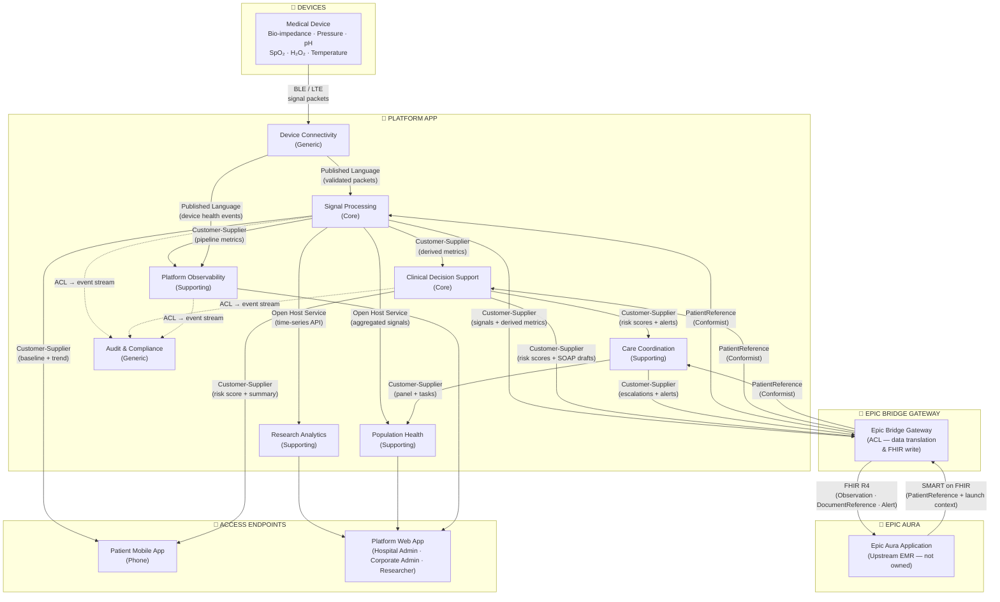

# Context Map — Multi-Signal Device



## Data Flow

```
Medical Device
      │  BLE / LTE
      ▼
Device Connectivity  ──►  Signal Processing  ──►  Clinical Decision Support
                                │                          │
                                ▼                          ▼
                         Patient Mobile App         Care Coordination
                                                          │
                     ┌────────────────────────────────────┘
                     ▼
            Epic Bridge Gateway  ──►  FHIR R4  ──►  Epic Aura Application
                                                    (Clinician · Care Team
                                                     via Epic Aura UI)
                     │
                     ▼
            Platform Web App
          (Hospital Admin · Corporate Admin · Researcher)
```

## Access Endpoints by Persona

| Persona | Access Channel | How |
|---|---|---|
| **Patient** | Mobile phone app | Direct — Platform App pushes simplified vitals, alerts |
| **Clinician** | Epic Aura app | SMART on FHIR embedded — risk scores, SOAP drafts appear inside Epic |
| **Care Team** | Epic Aura app | SMART on FHIR embedded — escalation queue inside Epic |
| **Researcher** | Platform web app | Direct — cohort explorer, signal export |
| **Hospital Administrator** | Platform web app | Direct — population health, readmission dashboards |
| **Corporate Administrator** | Platform web app | Direct — system health, SLA, error codes |

## Relationship Key

| Pattern | Meaning |
|---|---|
| **Epic Bridge Gateway (ACL)** | Translates platform domain objects (RiskAssessment, Escalation, SignalObservation) into FHIR R4 resources. Epic concepts never leak into core domain. |
| **SMART on FHIR** | Epic Aura passes PatientReference on launch — the only patient identifier stored on this platform (session only, never persisted) |
| **FHIR R4 Write** | Platform pushes Observation, DocumentReference, and Alert resources to Epic Aura via the bridge |
| **Published Language** | Shared schema for signal packets (device → platform) |
| **Customer-Supplier** | Upstream produces, downstream consumes |
| **Open Host Service** | Single API serving multiple downstream consumers |

## Patient Data Boundary

This platform stores **no patient profile data**. `PatientReference` is an opaque Epic FHIR Patient ID held in session memory only — never written to a database. All records are keyed to this reference.
