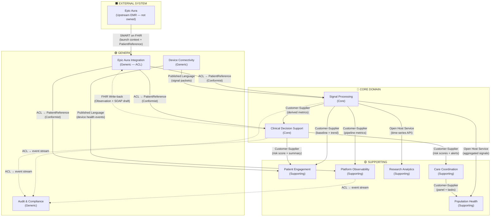

# Context Map — Multi-Signal Device

## Relationship Key

| Pattern | Meaning |
|---|---|
| **SMART on FHIR** | Epic Aura launches the platform and passes PatientReference — Epic is upstream, this platform conforms |
| **ACL (Anti-Corruption Layer)** | Epic Aura Integration translates Epic FHIR concepts into this platform's `PatientReference` value object — Epic concepts never leak into core domain |
| **FHIR Write-back** | CDS optionally posts risk scores and SOAP drafts back to Epic as FHIR resources — one-way push only |
| **Published Language** | Shared schema for signal packets (device → platform) and device health events |
| **Customer-Supplier** | Upstream produces, downstream consumes — upstream is responsive to downstream needs |
| **Open Host Service** | Single well-defined API serving multiple downstream consumers |
| **Conformist** | Downstream adopts `PatientReference` from Epic Aura Integration as-is |

## Patient Data Boundary

This platform stores **no patient profile data**. The only patient identifier is `PatientReference` — an opaque Epic FHIR Patient ID held in session memory only, never persisted to a database. All clinical records (signal observations, risk assessments, escalations) are keyed to this reference.
