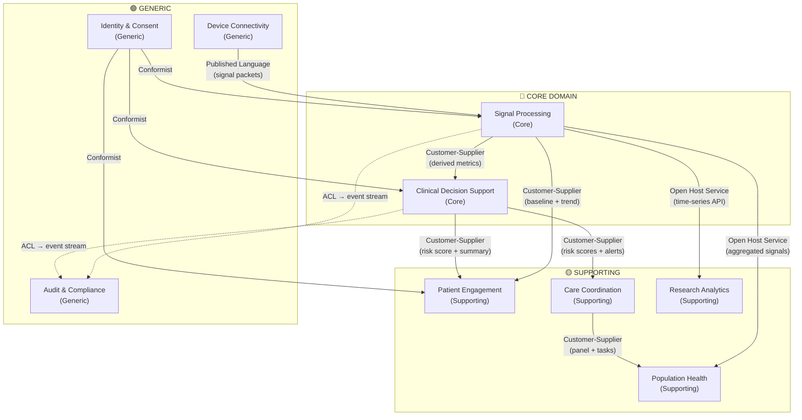

# Context Map — Multi-Signal Device

## Relationship Key

| Pattern | Meaning |
|---|---|
| **Published Language** | Shared schema for signal packets from device to platform |
| **Customer-Supplier** | Upstream produces, downstream consumes — upstream is responsive to downstream needs |
| **Open Host Service** | Single well-defined API serving multiple downstream consumers |
| **Conformist** | Downstream adopts upstream model as-is (IAM, consent) |
| **ACL (Anti-Corruption Layer)** | Event stream translated at boundary — audit context never leaks domain concepts back upstream |
