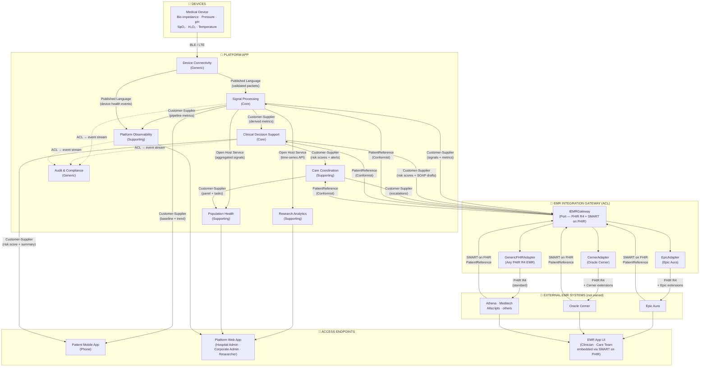

# Context Map — Multi-Signal Device



## Data Flow

```
Medical Device (BLE / LTE)
        │
        ▼
Device Connectivity  ──►  Signal Processing  ──►  Clinical Decision Support
                                │                          │
                                ▼                          ▼
                         Patient Mobile App         Care Coordination
                                                          │
               ┌──────────────────────────────────────────┘
               ▼
   IEMRGateway Port  (FHIR R4 + SMART on FHIR)
        │            │              │
        ▼            ▼              ▼
  EpicAdapter  CernerAdapter  GenericFHIRAdapter
        │            │              │
        ▼            ▼              ▼
   Epic Aura    Oracle Cerner   Athena · Meditech · others
        │            │              │
        └────────────┴──────────────┘
                     │
                     ▼
              EMR App UI
          (Clinician · Care Team
           embedded via SMART on FHIR)
```

## Port & Adapter Interface

```python
class IEMRGateway:
    """Port — implemented by each vendor adapter."""

    def get_patient_reference(self, launch_token: str) -> PatientReference: ...
    def write_observation(self, ref: PatientReference, obs: SignalObservation) -> str: ...
    def write_risk_score(self, ref: PatientReference, assessment: RiskAssessment) -> str: ...
    def write_soap_draft(self, ref: PatientReference, assessment: RiskAssessment) -> str: ...
    def write_escalation_alert(self, ref: PatientReference, esc: Escalation) -> str: ...
```

Each adapter implements this interface and handles vendor-specific FHIR extensions, auth scopes, and non-standard fields internally. The platform domain never calls an adapter directly — only through the port.

## What is Generic vs. Vendor-Specific

| Concern | Generic (works everywhere) | Vendor-Specific (adapter handles) |
|---|---|---|
| Auth | SMART on FHIR OAuth2 | App marketplace registration (App Orchard, Cerner Gallery) |
| Patient identity | FHIR `Patient` resource ID | Custom MRN formats, Epic EPI vs Cerner MPI |
| Signal write-back | FHIR R4 `Observation` | Custom LOINC code mappings per EMR |
| SOAP draft | FHIR R4 `DocumentReference` | Epic-specific note type codes |
| Escalation | FHIR R4 `Communication` | Epic In-Basket vs Cerner Message Center |
| Launch | SMART on FHIR launch URL | Epic App Orchard vs Cerner App Gallery |

## Access Endpoints by Persona

| Persona | Channel | How |
|---|---|---|
| **Patient** | Mobile phone app | Platform App pushes simplified vitals, alerts directly |
| **Clinician** | EMR app (Epic / Cerner / other) | SMART on FHIR embedded — risk scores and SOAP drafts appear inside their EMR |
| **Care Team** | EMR app (Epic / Cerner / other) | SMART on FHIR embedded — escalation queue inside their EMR |
| **Researcher** | Platform web app | Direct — cohort explorer, signal export |
| **Hospital Administrator** | Platform web app | Direct — population health, readmission dashboards |
| **Corporate Administrator** | Platform web app | Direct — system health, SLA, error codes |

## Patient Data Boundary

This platform stores **no patient profile data**. `PatientReference` is an opaque FHIR Patient ID from whichever EMR is connected, held in session memory only — never written to a database. All records (signal observations, risk assessments, escalations) are keyed to this reference.
