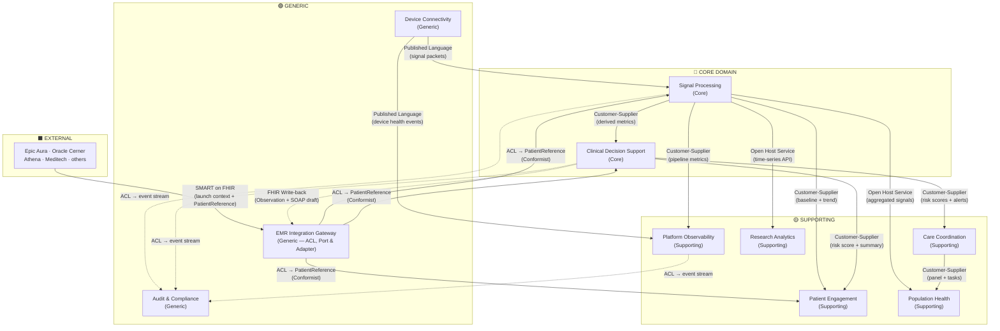
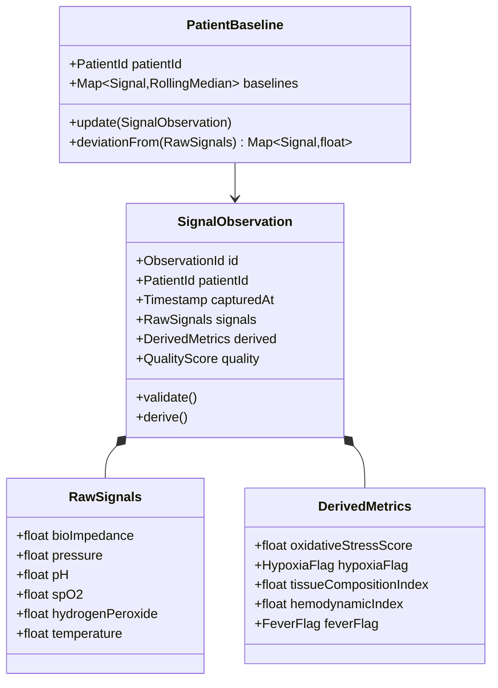
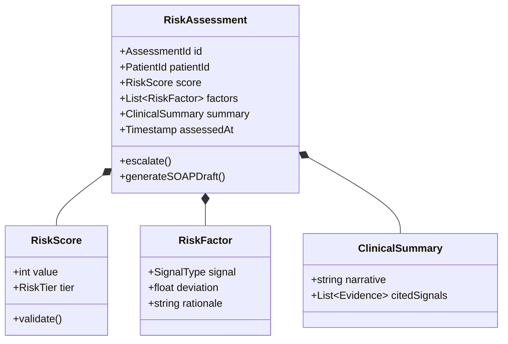

# Multi-Signal Device — Domain-Driven Design

*Date: 2026-09-25*
*Signals: Bio-impedance · Pressure · pH · SpO₂ · Hydrogen Peroxide · Temperature*

---

## Access Endpoints by Persona

| Persona | Channel | How |
|---|---|---|
| **Patient** | Mobile phone app | Platform App pushes simplified vitals, SpO₂/pH/temp trends, plain-language alerts |
| **Clinician** | Epic Aura app | SMART on FHIR embedded — risk scores, SOAP drafts, threshold breach log appear inside Epic |
| **Care Team** | Epic Aura app | SMART on FHIR embedded — escalation queue and care coordination inside Epic |
| **Researcher** | Platform web app | Direct — cohort explorer, signal export, feature library |
| **Hospital Administrator** | Platform web app | Direct — population health, readmission dashboards |
| **Corporate Administrator** | Platform web app | Direct — system health, SLA, error codes, device fleet |

## Data Flow

```
Medical Device (BLE / LTE)
        │
        ▼
Device Connectivity  ──►  Signal Processing  ──►  Clinical Decision Support
                                │                          │
                                ▼                          ▼
                         Patient Mobile App         Care Coordination
                                                          │
                     ┌────────────────────────────────────┘
                     ▼
   IEMRGateway Port  ──►  EMR Adapter  ──►  EMR App (Clinician · Care Team
                                                    embedded via SMART on FHIR)
                     │
                     ▼
            Platform Web App
          (Hospital Admin · Corporate Admin · Researcher)
```

---

## Subdomain Classification

| Bounded Context | Subdomain | Rationale |
|---|---|---|
| Signal Processing | **Core** | 6-signal fusion and derived metric computation (oxidative stress, hypoxia flag, tissue index) is the competitive moat |
| Clinical Decision Support | **Core** | Risk scoring, anomaly detection, and LLM clinical summaries differentiate the platform clinically |
| Patient Engagement | Supporting | Domain-specific but not the differentiator — simplified views, plain-language alerts |
| Care Coordination | Supporting | Necessary for clinical workflow; escalation queues, panel management |
| Research Analytics | Supporting | Cohort segmentation, feature library, raw signal access |
| Population Health | Supporting | Risk stratification and readmission scoring for hospital administrators |
| Platform Observability | Supporting | Device fleet health, pipeline SLA, error codes, data loss, connectivity metrics — serves Corporate Administrator |
| Audit & Compliance | Generic | Solved problem — immutable event log, consent, lineage, compliance export |
| Device Connectivity | Generic | Commodity IoT — BLE/LTE uplink, edge pre-processing, packet validation |
| EMR Integration Gateway | Generic | Port & Adapter ACL — `IEMRGateway` port with vendor adapters (Epic, Cerner, GenericFHIR). Translates platform objects into FHIR R4 resources. Receives PatientReference via SMART on FHIR. No patient profile stored on platform. |

---

## Ubiquitous Language

### Signal Processing

| Term | Definition |
|---|---|
| **Signal** | A raw sensor reading: impedance (Ω), pH (units), SpO₂ (%), temperature (°C), H₂O₂ (μM), pressure (mmHg) |
| **Observation** | A validated, normalized multi-signal snapshot captured at a single timestamp |
| **Derived Metric** | A computed value from one or more raw signals — oxidative stress score, hypoxia flag, tissue composition index, hemodynamic index, fever flag |
| **Baseline** | Personal rolling 7-day median per signal per patient |
| **Deviation** | Signed distance from baseline in standard deviations |
| **Quality Score** | A 0–1 confidence value indicating signal integrity (noise, electrode contact, motion artifact) |

### Clinical Decision Support

| Term | Definition |
|---|---|
| **Risk Assessment** | A scored evaluation (0–100) of a patient's clinical state at a point in time |
| **Risk Factor** | A single signal deviation that contributed to the risk score, with rationale |
| **Risk Tier** | Categorical label: Low / Moderate / High / Critical |
| **Clinical Summary** | An LLM-generated narrative citing the signal evidence that drove the assessment |
| **SOAP Draft** | A structured clinical note (Subjective, Objective, Assessment, Plan) pre-populated from the assessment |

### Care Coordination

| Term | Definition |
|---|---|
| **Escalation** | A ranked work item representing a patient who requires care team attention |
| **Panel** | The set of patients assigned to a care team |
| **Deterioration Velocity** | Rate of risk score increase over a configurable window |

### Patient Engagement

| Term | Definition |
|---|---|
| **Alert** | A plain-language notification surfaced to the patient ("Your SpO₂ is slightly below your baseline today") |
| **Trend** | A 7-day sparkline of one signal |

### EMR Integration Gateway

| Term | Definition |
|---|---|
| **IEMRGateway** | The port (abstract interface) through which the platform talks to any EMR. Never references a specific vendor. |
| **EMR Adapter** | A vendor-specific implementation of `IEMRGateway` — one per EMR (EpicAdapter, CernerAdapter, GenericFHIRAdapter). Handles vendor quirks internally. |
| **PatientReference** | An opaque value object — the FHIR Patient ID from whichever EMR is connected, received via SMART on FHIR launch context. The only patient identifier on this platform. Never contains name, DOB, or MRN. |
| **SMART Launch Context** | The OAuth2 token bundle an EMR passes when a clinician opens this platform. Contains `patient`, `encounter`, and `practitioner` claims. Standard across all FHIR-compliant EMRs. |
| **FHIR R4 Observation** | Standard resource used to write signal readings and risk scores back to the EMR |
| **FHIR R4 DocumentReference** | Standard resource used to write SOAP draft notes back to the EMR |
| **FHIR R4 Communication** | Standard resource used to write escalation alerts back to the EMR |
| **LOINC Code** | Standard clinical terminology code mapped per signal type — used in FHIR Observation resources so any EMR can interpret the reading |

**Port interface:**
```python
class IEMRGateway:
    def get_patient_reference(self, launch_token: str) -> PatientReference: ...
    def write_observation(self, ref: PatientReference, obs: SignalObservation) -> str: ...
    def write_risk_score(self, ref: PatientReference, assessment: RiskAssessment) -> str: ...
    def write_soap_draft(self, ref: PatientReference, assessment: RiskAssessment) -> str: ...
    def write_escalation_alert(self, ref: PatientReference, esc: Escalation) -> str: ...
```

**Adapters:**
| Adapter | EMR | Notes |
|---|---|---|
| `EpicAdapter` | Epic Aura | Epic App Orchard registration, Epic FHIR extensions, In-Basket alerts |
| `CernerAdapter` | Oracle Cerner | Cerner App Gallery registration, Cerner FHIR extensions, Message Center |
| `GenericFHIRAdapter` | Any FHIR R4 EMR | Standard FHIR R4 only — Athena, Meditech, Allscripts, others |

**What this platform does NOT store:**
- Patient name, date of birth, address, MRN
- Insurance or billing information
- Existing diagnoses or medication list
- Any EMR-internal clinical data

**Integration flow:**
1. Clinician opens this platform from their EMR (SMART on FHIR launch)
2. EMR passes `PatientReference` (FHIR Patient ID) in the launch token
3. Correct adapter is selected based on registered EMR vendor
4. Platform keys all signal observations, risk assessments, and escalations to `PatientReference`
5. Optionally writes risk scores, SOAP drafts, and escalation alerts back to the EMR via the adapter

---

### Corporate Administrator (Platform Observability)

| Term | Definition |
|---|---|
| **Device Health** | Connectivity state of a single patient device — Online / Degraded / Offline |
| **Packet Loss Rate** | % of expected signal packets not received in a time window |
| **Signal Completeness Score** | % of expected observations actually ingested per patient per day |
| **Pipeline Latency** | End-to-end time from device transmission to derived metric availability (P50/P95/P99) |
| **Error Code** | Structured fault identifier — categories: device firmware, calibration failure, transmission error, processing failure |
| **SLA Breach** | Any metric that crosses a defined operational threshold (e.g., uptime < 99.5%, latency P99 > 5s) |
| **Data Loss Event** | A gap in signal time-series exceeding the configured tolerance window |

---

## Context Map



---

## Aggregate Design

### Signal Processing — `SignalObservation` (Aggregate Root)



**Invariants:**
- `quality` must be ≥ 0.6 for `derived` to be populated
- All six raw signal fields must be present or the observation is rejected
- `capturedAt` must not be in the future

### Clinical Decision Support — `RiskAssessment` (Aggregate Root)



**Invariants:**
- `score.value` must be 0–100
- At least one `RiskFactor` must exist if `score.tier` is Moderate or higher
- `summary.citedSignals` must reference only signals present in the triggering `SignalObservation`

### Care Coordination — `Escalation` (Aggregate Root)

| Field | Type | Notes |
|---|---|---|
| `id` | EscalationId | |
| `patientId` | PatientId | |
| `riskScore` | int | Snapshot from CDS at escalation time |
| `severity` | Low / Moderate / High / Critical | |
| `assignedTo` | CareTeamMemberId? | Nullable until assigned |
| `status` | Open / Acknowledged / Resolved | |
| `deteriorationVelocity` | float | Risk score delta per hour |
| `openedAt` | Timestamp | |
| `resolvedAt` | Timestamp? | |

---

## Domain Events Catalog

| Event | Raised By | Payload | Consumed By |
|---|---|---|---|
| `SignalObservationRecorded` | Signal Processing | observationId, patientId, capturedAt, qualityScore | CDS, Patient Engagement, Research Analytics |
| `BaselineUpdated` | Signal Processing | patientId, signal, newMedian | CDS |
| `HypoxiaFlagRaised` | Signal Processing | patientId, spO2Value, deviation | CDS, Care Coordination |
| `OxidativeStressSpikeDetected` | Signal Processing | patientId, score, pH, H₂O₂ | CDS |
| `FeverFlagRaised` | Signal Processing | patientId, temperatureValue | CDS, Patient Engagement |
| `RiskAssessmentCompleted` | CDS | assessmentId, patientId, score, tier | Care Coordination, Patient Engagement, Population Health |
| `EscalationTriggered` | Care Coordination | escalationId, patientId, severity | Patient Engagement |
| `EscalationResolved` | Care Coordination | escalationId, resolvedBy, resolvedAt | Population Health |
| `PatientSessionEstablished` | EMR Integration Gateway | patientReference (FHIR Patient ID), practitionerId, encounterId, emrVendor, launchedAt | Signal Processing, CDS, Patient Engagement |
| `PatientSessionExpired` | EMR Integration Gateway | patientReference, expiredAt | All contexts |
| `RiskScoreWrittenToEMR` | EMR Integration Gateway | patientReference, assessmentId, fhirObservationId, emrVendor | Audit & Compliance |
| `SOAPDraftWrittenToEMR` | EMR Integration Gateway | patientReference, assessmentId, fhirDocumentReferenceId, emrVendor | Audit & Compliance |
| `DeviceOfflineDetected` | Device Connectivity | deviceId, patientId, lastSeenAt | Platform Observability |
| `PacketLossThresholdBreached` | Signal Processing | deviceId, patientId, lossRate, windowMinutes | Platform Observability |
| `DataLossEventDetected` | Signal Processing | patientId, signal, gapStart, gapEnd | Platform Observability, CDS |
| `PipelineLatencyBreached` | Signal Processing | stage, p99LatencyMs, thresholdMs | Platform Observability |
| `SLABreachTriggered` | Platform Observability | metricName, currentValue, threshold, severity | Corporate Administrator |

---

## Tech Stack Mapping

| Bounded Context | Component | Technology |
|---|---|---|
| **Device Connectivity** | Edge gateway | AWS IoT Greengrass / Azure IoT Hub |
| **Device Connectivity** | Packet validation | Python microservice on edge |
| **Signal Processing** | Signal ingestion | Apache Kafka (event stream) |
| **Signal Processing** | Normalization + derivation | Python service (NumPy / SciPy) |
| **Signal Processing** | Time-series store | InfluxDB or TimescaleDB |
| **Signal Processing** | Baseline engine | Redis (rolling window per patient) |
| **Clinical Decision Support** | Risk scoring models | MLflow + scikit-learn / XGBoost |
| **Clinical Decision Support** | LLM clinical summaries | Claude API (Haiku for speed, Sonnet for quality) |
| **Clinical Decision Support** | Anomaly detection | Isolation Forest / LSTM autoencoder |
| **Patient Engagement** | API | FastAPI (Python) |
| **Patient Engagement** | Mobile / web UI | React Native / React |
| **Care Coordination** | API + queue engine | FastAPI + PostgreSQL |
| **Care Coordination** | Real-time push | WebSocket / Firebase |
| **Research Analytics** | Cohort query engine | DuckDB or Databricks SQL |
| **Research Analytics** | Feature store | Feast or Databricks Feature Store |
| **Population Health** | Dashboards | Databricks + Power BI / Tableau |
| **Platform Observability** | Device & pipeline metrics store | InfluxDB / Prometheus + Grafana |
| **Platform Observability** | Error code log & alerting | PagerDuty / Azure Monitor |
| **Platform Observability** | SLA dashboard | Grafana or Power BI |
| **Audit & Compliance** | Immutable event log | Apache Kafka + S3 (WORM) / Azure Event Hubs |
| **Audit & Compliance** | Lineage tracking | OpenLineage / Marquez |
| **EMR Integration Gateway** | Port interface | Python abstract base class `IEMRGateway` |
| **EMR Integration Gateway** | SMART on FHIR auth (all vendors) | `smart-on-fhir` / `python-smart-client` library |
| **EMR Integration Gateway** | EpicAdapter | Epic FHIR R4 API + Epic App Orchard registration |
| **EMR Integration Gateway** | CernerAdapter | Oracle Cerner FHIR R4 API + Cerner App Gallery registration |
| **EMR Integration Gateway** | GenericFHIRAdapter | Standard FHIR R4 (`/Patient`, `/Observation`, `/DocumentReference`, `/Communication`) |
| **EMR Integration Gateway** | LOINC code registry | Static mapping file — signal type → LOINC code |
| **EMR Integration Gateway** | PatientReference | In-memory session only — never persisted to DB |
| **Patient Mobile App** | Mobile frontend | React Native (iOS + Android) |
| **Platform Web App** | Web frontend | React + FastAPI backend |

---

## Repository Interfaces

```python
# Signal Processing
class SignalObservationRepository:
    def save(self, observation: SignalObservation) -> None: ...
    def find_by_patient(self, patient_id: PatientId, since: datetime) -> list[SignalObservation]: ...

class PatientBaselineRepository:
    def find_by_patient(self, patient_id: PatientId) -> PatientBaseline | None: ...
    def save(self, baseline: PatientBaseline) -> None: ...

# Clinical Decision Support
class RiskAssessmentRepository:
    def save(self, assessment: RiskAssessment) -> None: ...
    def latest_for_patient(self, patient_id: PatientId) -> RiskAssessment | None: ...
    def find_by_tier(self, tier: RiskTier, since: datetime) -> list[RiskAssessment]: ...

# Care Coordination
class EscalationRepository:
    def save(self, escalation: Escalation) -> None: ...
    def open_by_severity(self, severity: Severity) -> list[Escalation]: ...
    def assign(self, escalation_id: EscalationId, member_id: CareTeamMemberId) -> None: ...
```
